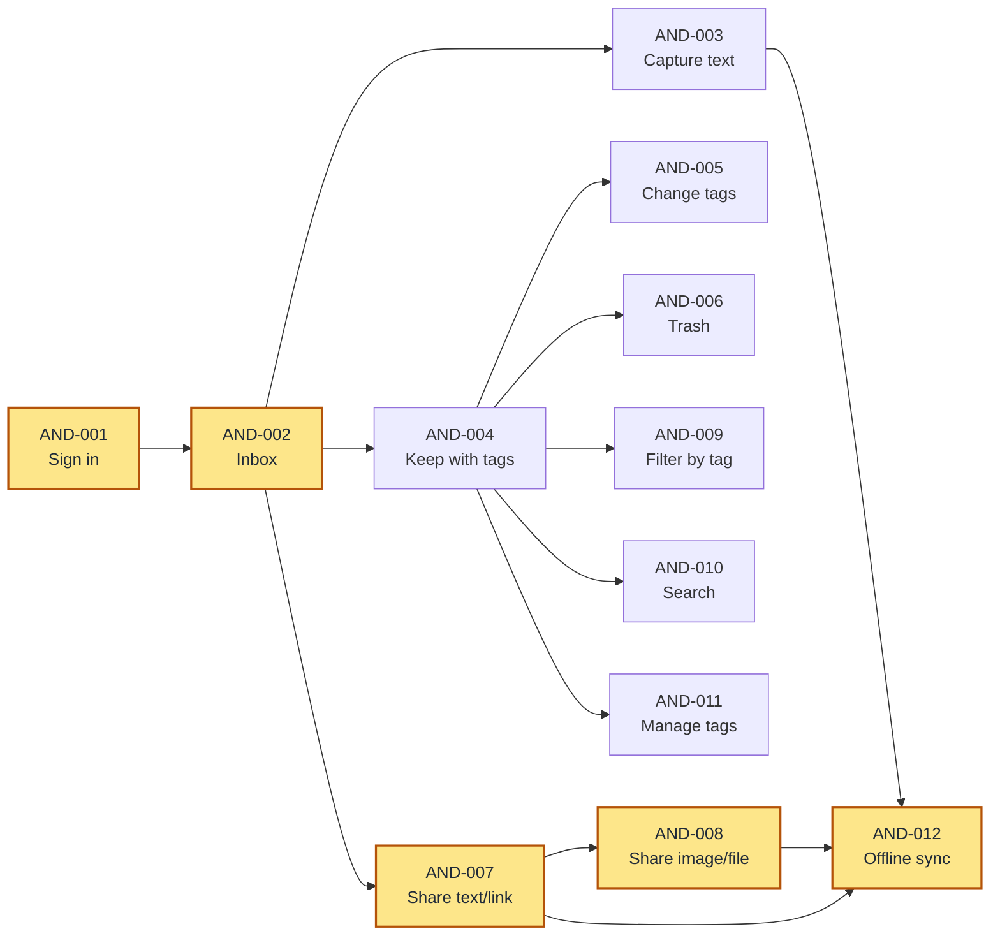

# Stash Android app

## Overview

The Android app is one of the three Stash clients. It lets me capture from any app through
the share sheet, triage what is waiting in the Inbox, browse the Library by tag, search the
content I have kept, and recover items from the Trash. Captures made without a connection
wait and sync when the connection returns.

These stories cover only the Android client. They assume the Stash API in the
[project proposal](../PROPOSAL.md) exists and behaves as described there; the web app and
browser extension have their own stories. The app already has Google sign-in and placeholder
Inbox, Library, and Trash screens. AND-001 records the sign-in behaviour the finished app
must keep.

## Goals

- Capture text, links, images, and files from any Android app through the share sheet.
- Triage from the phone: keep with tags, or drop into a recoverable Trash.
- Find kept content by tag and by searching its content.
- Accept captures while offline and sync them without loss or duplicates.
- Keep every screen usable when a request fails, times out, or the session expires.

## Delivery Order

Everything waits on signing in and then on the Inbox. Once the Inbox lands, manual capture,
keeping, and sharing can run in parallel. Keeping is the second bottleneck: changing tags,
the Trash flow, tag filtering, search, and tag management all wait on it.

The shaded chain — sign in, Inbox, shared text/link, shared image/file, offline sync — is the
critical path at five steps deep. Offline sync cannot land until every capture path works,
which is why it sits at the end of that chain.

## User Stories

### AND-001: Sign in and stay signed in

**Description:** As a Stash user, I want to sign in with Google and stay signed in so that I
can reach my stash without signing in every time.

**Acceptance Criteria:**
- [ ] When I am signed out, the app shows a "Continue with Google" action and no stash content.
- [ ] Completing Google sign-in opens the Inbox.
- [ ] I remain signed in after closing and reopening the app.
- [ ] When my session is no longer valid, the app returns me to sign-in with a clear message.
- [ ] I can sign out from every main screen, after which my items are no longer shown.
- [ ] If sign-in fails, the app shows a clear message and lets me try again.

**Context:** Sign-in is already in place. This story locks in the behaviour it must keep as
the rest of the app is built. Google is the identity provider; the app should not assume it
is the only provider forever.

### AND-002: See the Inbox and open an item

**Description:** As a Stash user, I want to see everything waiting for triage and open any
item so that I can decide what to keep or drop.

**Acceptance Criteria:**
- [ ] The Inbox is the first screen after sign-in.
- [ ] The Inbox lists unsorted items newest first, showing each item's type and a readable
  summary: a text preview, a link title or URL, an image thumbnail, or a file name and size.
- [ ] Each item shows the app it came from when that is known.
- [ ] Tapping an item opens a detail view with its full content, its source, and when it was
  saved.
- [ ] A link's title and description appear in the list and detail once they are fetched;
  until then the app shows the URL.
- [ ] Pulling down refreshes the list.
- [ ] An empty Inbox explains what the Inbox is for and how to capture something; a failed
  load shows a clear message and a Retry action.

**Context:** A capture can take a moment to appear in the Inbox after it is made. The app
should treat that moment as normal rather than as a lost capture.

**Depends on:** AND-001

### AND-003: Capture text from the app

**Description:** As a Stash user, I want to save a thought as text without leaving the app so
that I can capture it quickly.

**Acceptance Criteria:**
- [ ] The Inbox has a capture action that opens a text entry screen.
- [ ] I can type or paste text and save it.
- [ ] Empty or whitespace-only text cannot be saved, and the app explains why.
- [ ] After saving, the text appears in my Inbox.
- [ ] I can cancel without creating an item.
- [ ] If saving fails, my text stays in the entry screen so that I can retry.

**Context:** Writing text in the app is a convenience. The share sheet remains the main way
to capture from other apps.

**Depends on:** AND-002

### AND-004: Keep an item with tags

**Description:** As a Stash user, I want to keep an Inbox item and tag it so that it moves to
my Library where I can find it later.

**Acceptance Criteria:**
- [ ] Swiping right on an Inbox item starts Keep for that item.
- [ ] Keep shows a tag picker with my existing tags and lets me create a new tag by name.
- [ ] I can choose one or more tags and confirm.
- [ ] Confirming removes the item from my Inbox and adds it to my Library with those tags.
- [ ] The Library lists kept items newest first, and tapping one opens its detail.
- [ ] Keep is also available from the item detail screen; cancelling leaves the item in the
  Inbox unchanged.
- [ ] A failed Keep leaves the item in the Inbox and shows an error with a Retry action.

**Context:** An item can have many tags, and a tag can belong to many items. Keeping and
tagging are separate ideas: changing tags later must not move the item out of the Library.

**Depends on:** AND-002

### AND-005: Change an item's tags

**Description:** As a Stash user, I want to change the tags on a kept item so that my Library
stays accurate as my categories change.

**Acceptance Criteria:**
- [ ] I can edit the tags of any kept item from its detail view.
- [ ] I can add existing tags, remove tags, and create a new tag while editing.
- [ ] Saving leaves the item in the Library and updates its tags everywhere it appears.
- [ ] The same tag cannot be assigned to an item twice.
- [ ] Cancelling leaves the tags unchanged.

**Depends on:** AND-004

### AND-006: Drop, restore, and empty the Trash

**Description:** As a Stash user, I want to drop items without fear and recover them so that
triage stays reversible.

**Acceptance Criteria:**
- [ ] Swiping left on an Inbox or Library item drops it into the Trash, with a brief chance
  to undo.
- [ ] Drop is also available from the item detail screen.
- [ ] The Trash lists dropped items newest first with a readable summary and when each was
  dropped.
- [ ] Restoring an item returns it to the Inbox if it was never kept, or to the Library if
  it was kept.
- [ ] I can permanently delete one item after confirming.
- [ ] I can empty the whole Trash after confirming how many items will go.
- [ ] After a permanent delete or empty, the item no longer appears anywhere; an empty Trash
  shows a clear empty state.

**Context:** Drop is a soft delete. Permanent deletion is only possible from the Trash.

**Depends on:** AND-004

### AND-007: Capture shared text and links from other apps

**Description:** As a Stash user, I want to share text or a link from any app to Stash so
that I can capture without switching apps.

**Acceptance Criteria:**
- [ ] Stash appears in the Android share sheet for text.
- [ ] Sharing text saves a text item; sharing a single URL saves a link item with that URL
  as its source.
- [ ] The item records the app it was shared from when Android provides it; capture still
  succeeds when it does not.
- [ ] A shared link is saved even when its title and description cannot be fetched.
- [ ] After sharing, I see a confirmation and can open the Inbox to find the item.
- [ ] If the capture fails, I see a clear message and can retry.

**Context:** The link's title and description are fetched after capture, so the share action
stays quick. A link that cannot be enriched is still a successful capture.

**Depends on:** AND-002

### AND-008: Capture shared images and files from other apps

**Description:** As a Stash user, I want to share photos and files from any app to Stash so
that I can keep them alongside my other captures.

**Acceptance Criteria:**
- [ ] Stash appears in the Android share sheet for images and files.
- [ ] Sharing one image creates one image item with a thumbnail in the Inbox.
- [ ] Sharing several images at once creates one item per image.
- [ ] Sharing a file creates a file item showing its name, size, and type.
- [ ] An image or file over 25 MB is refused with a clear message, and no item is created.
- [ ] A video is refused with a clear message, and no item is created.
- [ ] I can open a saved file from the item detail, and the source app is recorded when
  Android provides it.

**Context:** One item has one attachment in v1, which is why a multi-image share becomes
several items. The 25 MB cap and the video exclusion are product limits, not transient
errors.

**Depends on:** AND-007

### AND-009: Filter the Library by tag

**Description:** As a Stash user, I want to narrow my kept items by tag so that I can find
what I saved without scrolling through everything.

**Acceptance Criteria:**
- [ ] The Library has a tag filter built from the tags I have created or used.
- [ ] Choosing a tag shows only kept items with that tag.
- [ ] Clearing the filter shows all kept items.
- [ ] The chosen filter stays visible while I browse.
- [ ] When no kept items have the chosen tag, the Library explains that and lets me clear
  the filter.

**Depends on:** AND-004

### AND-010: Search saved items

**Description:** As a Stash user, I want to search the content I have saved so that I can
find a note or link without remembering its tags.

**Acceptance Criteria:**
- [ ] The Library has a search field.
- [ ] Results update as I type, without a separate search action.
- [ ] Search covers text content and link titles, descriptions, and URLs.
- [ ] Each result shows the matching content so that I can tell why it matched.
- [ ] No matches shows a "no results" state and keeps my query editable.
- [ ] Clearing the search restores the Library list.

**Context:** Search reads the captured content and the fetched link metadata. It is not a
search of the page behind a link.

**Depends on:** AND-004

### AND-011: Manage tags

**Description:** As a Stash user, I want to create and rename tags so that my tagging system
can grow without leaving the app.

**Acceptance Criteria:**
- [ ] I can see every tag I have created or used.
- [ ] I can create a tag by name.
- [ ] I can rename a tag.
- [ ] A name that matches an existing tag, ignoring case, is refused with a clear message.
- [ ] Renaming updates the tag wherever it appears.
- [ ] Tag management is reachable from the Library.

**Context:** Tags can be created and renamed. Deleting a tag is not part of v1.

**Depends on:** AND-004

### AND-012: Capture offline and sync later

**Description:** As a Stash user, I want captures made without a connection to wait and sync
later so that I never lose something because I was offline.

**Acceptance Criteria:**
- [ ] A capture made while offline is accepted and marked pending.
- [ ] The Inbox shows a pending banner with a count of captures waiting to sync, and pending
  captures survive closing and reopening the app.
- [ ] When a connection returns while the app is open, pending captures sync automatically
  in the order I made them.
- [ ] A synced capture leaves the pending state and appears in the Inbox exactly once.
- [ ] A failed sync retries automatically; if it keeps failing, I see an error with Retry
  and Discard actions.
- [ ] If my session expires while captures are pending, I am asked to sign in and the
  pending captures are kept.

**Context:** This covers captures shared from other apps and text written in the app.
Retrying must not create a second copy of an item that already reached the server.

**Depends on:** AND-003, AND-007, AND-008

## Non-Goals

- iOS client; the app is Android only in v1.
- Multi-user collaboration, sharing, or a shared Library.
- Web app and browser extension work; those are separate clients.
- Warning about duplicate captures; duplicates are allowed in v1.
- AI tagging or summaries.
- Video capture.
- More than one attachment per item; sharing several images creates one item per image.
- Editing the captured content of an item after it is saved; only its tags and its
  Inbox/Library/Trash location can change.
- Deleting tags; tags can be created and renamed.
- Full-page archival or offline reading of saved links.
- Background sync while the app is closed; syncing happens while the app is open.
- Notifications, home-screen widgets, and quick-settings tiles.

## Open Questions

- Must every kept item have at least one tag? The proposal says Keep assigns one or more,
  but leaves keep-without-tags open. These stories currently require at least one.
- Should the app let me set the Stash server address at runtime, or is it fixed when the app
  is built? Self-hosted deployments live at different addresses.
- Should a capture shared while signed out be kept through sign-in, or should the app ask me
  to sign in first and make me share again?
- Should signing out warn me about pending captures, or keep them for the next time I sign
  in?
- Should search cover only the Library, or also the Inbox and Trash?
- Should search and a tag filter combine, or should search always cover every kept item?
- Should a shared block of text that contains a URL be saved as a link or as text?
