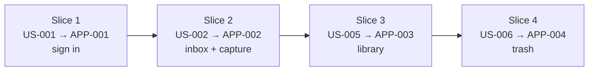

# M2 — Flutter app (Android + Web)

The client codebase for Stash: one Flutter app targeting Android and Web, working against
the Go service. These stories pair with the backend stories in `stash.md` — each backend
story exposes endpoints, and the matching app story makes them visible. **M2 is done when
auth and the Inbox/Library/Trash screens work against the API, in a browser and on a
device/emulator.**

## App stories

### APP-001: Sign in from the app

**Description:** As a user, I want to sign in with Google from the web app and the Android
app so I can reach my stash from either.

**Acceptance Criteria:**
- [ ] The web app shows a "Continue with Google" button that completes the sign-in.
- [ ] The Android app signs in with the same Google account.
- [ ] After signing in, the app stores the session token and stays signed in across restarts.
- [ ] Signing out returns to the sign-in screen and stops showing my items.
- [ ] A request made while signed out shows a sign-in prompt, not a broken screen.

**Depends on:** US-001

### APP-002: See the Inbox and capture text

**Description:** As a user, I want to see my Inbox and save a piece of text so I can triage
it later.

**Acceptance Criteria:**
- [ ] The Inbox lists my unsorted items, newest first.
- [ ] I can save a piece of text and see it appear in the Inbox.
- [ ] Tapping an Inbox item shows its full text and, when known, the app it came from.
- [ ] An empty Inbox shows a friendly message.

**Depends on:** US-002

### APP-003: Keep items into the Library

**Description:** As a user, I want to keep an Inbox item with tags so it moves to my Library.

**Acceptance Criteria:**
- [ ] A Keep action on an Inbox item assigns tags and moves it to the Library.
- [ ] The Library lists my kept items with their tags.
- [ ] I can change an item's tags without moving it out of the Library.

**Depends on:** US-005

### APP-004: Drop items and recover from the Trash

**Description:** As a user, I want to drop items and recover them so triage is never
destructive.

**Acceptance Criteria:**
- [ ] A Drop action moves an item to the Trash.
- [ ] The Trash lists my dropped items.
- [ ] I can restore a trashed item, permanently delete it, and empty the Trash.

**Depends on:** US-006

## Progressive delivery

Each slice is a vertical cut through backend and frontend, so every step ends with
something you can run and see:

| Slice | Backend | Frontend | You can now |
|---|---|---|---|
| 1 | US-001 Sign in | APP-001 Sign-in screen | sign in from the app |
| 2 | US-002 Capture text | APP-002 Inbox + capture | save text and see the Inbox |
| 3 | US-005 Keep | APP-003 Library | keep items and see the Library |
| 4 | US-006 Drop/recover | APP-004 Trash | drop and recover items |

The backend stories fan out after US-002 (US-003 link, US-004 image/file), but M2's four
screens need only the chain above. Those later stories add capture *types* to the Inbox
rather than new screens, so the app stays one codebase that grows in place.

## Beyond M2

The remaining backend stories extend these same screens, not new ones:

| Backend | Extends |
|---|---|
| US-003 link, US-004 image/file | capture types on the Inbox |
| US-007 tags | tag management and Library filtering |
| US-008 search | a search box |
| US-009 duplicates | a duplicate notice |
| US-010 Android share, US-012/US-013 extensions | capture entry points |
| US-014 thumbnails | image previews |
| US-015 failures | error, empty, and retry states |
