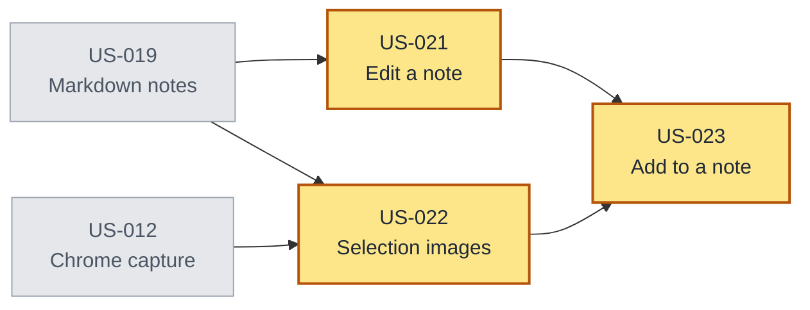

# Editing and appending notes

## Overview

A captured note can only be read today. There is no way to correct it, extend it, or add
something you found after you saved it. This feature makes a note's content editable, then uses
that capability in two places: the web app, where a note can be edited directly, and the
browser extension, which can add the current selection to a note you already have.

The stories continue the numbering in [stash.md](stash.md). US-019 and US-012 are already
delivered and are the prerequisites here.

## Goals

- Change any note's markdown after it is saved, without losing its tags or place.
- Keep a note safe from being silently overwritten when two people, or two tabs, edit it.
- Save a web selection that mixes text and images as one note, in its original order.
- Add a web selection to an existing note from the extension, with a deliberate choice of
  note.
- Never lose a capture because one of its images could not be downloaded.

## Delivery Order

The two prerequisites are already delivered: notes are markdown, and Chrome capture works.
Editing (US-021) and ordered selection capture (US-022) can start together. Adding to a note
(US-023) waits for both, because it needs the edit capability and a selection that keeps its
images.

The critical path is two new stories deep, in both directions: US-021 → US-023 and
US-022 → US-023 tie. US-023 is the bottleneck, not the start: it is the only story that cannot
begin until the other two land.

## User Stories

### US-021: Edit a saved note

**Description:** As a user, I want to change what a saved note says so that I can correct a
mistake or add to it after I saved it.

**Acceptance Criteria:**
- [ ] Opening a note in my Inbox or Library offers an edit action.
- [ ] The note opens as editable markdown, with its images shown where they are in the note.
- [ ] Saving keeps the note where it was, with its tags and when it was first saved.
- [ ] I can add images while editing, and they appear where I put them.
- [ ] Saving an empty note is refused with a clear message.
- [ ] If the note changed after I opened it, saving is refused, my edits stay on screen, and I
  am told to reload the note.
- [ ] Search finds text I added to the note.

**Context:** Text and notes are one kind of item (US-019), so editing a note edits the
captured text. The same change is what lets the browser extension add a selection to a note
(US-023). Editing applies to notes only; a link's title, an image, and a file have no content
to edit.

**Depends on:** US-019

### US-022: Save a selection with its images as one note

**Description:** As a user browsing the web, I want a selection that mixes text and images
saved as one note so that pictures stay where they were in the text.

**Acceptance Criteria:**
- [ ] Saving a selection that contains text and images creates one note.
- [ ] Each image appears at the position it held in the selection, including between
  paragraphs.
- [ ] An image Stash can download is stored, so the note still shows it after the source page
  is gone.
- [ ] If an image cannot be downloaded, its original address is used and the rest of the
  selection is still saved.
- [ ] A selection without images is saved as it is today.
- [ ] A selection that is only an image is saved as a note containing that image.
- [ ] A selection with more images than one note allows is refused with a message that states
  the limit.

**Context:** Today the extension asks the browser for the selected text only, so an image
inside the selection is dropped. A note is markdown, so an image is a markdown image at the
point it appeared. Images that Stash stores stay private to the user; an image referenced by
its address depends on the source page.

**Depends on:** US-012, US-019

### US-023: Add a selection to an existing note

**Description:** As a user browsing the web, I want to add the text and images I selected to a
note I already have so that I can build up one note while I read.

**Acceptance Criteria:**
- [ ] The extension offers a second action that adds the selection to an existing note rather
  than saving a new one.
- [ ] Choosing it shows my notes, newest first, each with its opening text and when it was
  saved, and it does not offer notes in the Trash.
- [ ] The selection is added after the note's content, separated by a blank line, with its
  images in their original order.
- [ ] Cancelling changes nothing.
- [ ] If the note changed since the list was shown, adding is refused with a message telling
  me to try again, and my selection is kept so I can retry.
- [ ] If an image cannot be downloaded, its original address is used and the rest of the
  selection is still added.
- [ ] Adding to a note does not change where it lives or its tags.

**Context:** A note can receive more than one addition. The addition is content only: the
note keeps its tags, its place in the Inbox or Library, and when it was first saved. Adding
to a note in the Trash is refused because that note is waiting to be deleted.

**Depends on:** US-021, US-022

## Non-Goals

- Editing anything other than a note's markdown: link titles, images, and files are unchanged.
- Editing a note that is in the Trash.
- Collaborative or simultaneous editing.
- Version history, undo after saving, or restoring an earlier version.
- Editing or appending from the Android app.
- Adding a selection to more than one note at once.
- Recording which page an added selection came from.
- Changing a note's tags, place, or first-saved time by editing it.
- Replacing an existing image's bytes; editing can add images but not edit the image itself.
- Appending from the web app; only the extension offers it in this increment.

## Open Questions

- Should an edit move the note to the top of its list? These stories keep the first-saved
  time, so a corrected note does not jump.
- Should the note picker show Inbox notes only, or Inbox and Library together? These stories
  assume both, with the Trash excluded.
- Should the picker support search? Not in this increment.
- What happens when repeated additions push a note's stored images past 100 MB? The limits
  apply per save, so the note's lifetime total is uncapped.
- Should the extension retry a refused addition automatically, or always ask the user?
- Does the web app get the editor in the same increment as US-021, or does the capability land
  with the extension first?
- Should an addition remember the page it came from, for provenance? These stories assume no.
