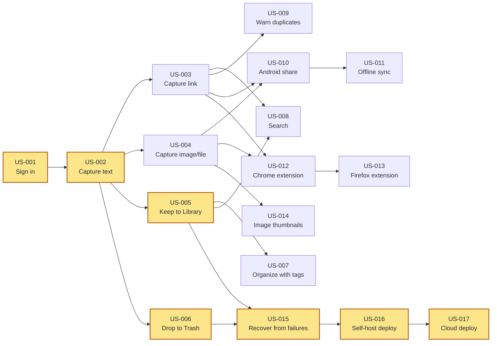

# Stash

## Overview

Stash is a self-hosted capture inbox: save text, images, links, and files from any app
on a phone or desktop, then sort them into tags or discard them. Everything lands in an
unsorted Inbox, is triaged into the Library (kept, tagged) or the Trash (dropped,
recoverable), and text and links are searchable. A story map for this feature lives at
[stash-story-map.html](stash-story-map.html).

## Goals

- Capture text, image, link, and file from any Android app and from a desktop browser.
- Land every capture in an Inbox, with the source app or URL recorded.
- Triage each item: keep (into tags) or drop (into trash), fast, from phone or web.
- Search saved text and links by content.
- Self-host by default, with a cloud deployment path behind the same interface.

## Delivery Order

Everything blocks on signing in, and then on the first text capture: four stories fan out
from US-002 alone, which is why it is the one to start after sign-in. Once the first
capture lands, capture types, triage, and tags can all proceed in parallel.

The shaded chain — sign in, capture, then both triage flows, failure handling, and the two
deployment stories — is the critical path, six steps deep. No other chain runs deeper than
five.

The Flutter app (Android + Web) stories live in [m2-flutter-app.md](m2-flutter-app.md);
each pairs with a backend story so the two codebases progress in visible slices.

## User Stories

### US-001: Sign in with your account

**Description:** As a user, I want to sign in with my Google account so that my stash is
private to me and I can reach it from every device.

**Acceptance Criteria:**
- [ ] On the web app, I can sign in with my Google account.
- [ ] On the Android app, I can sign in with the same Google account.
- [ ] From the browser extension, I can authenticate with the same Google account.
- [ ] After signing in once, I stay signed in across app restarts until I sign out.
- [ ] Requests to view or change items while signed out are refused with a clear message.
- [ ] I can sign out, after which my items are no longer shown.

**Context:** Google is the first sign-in provider. The sign-in path should treat the
provider as interchangeable so another provider (for example another OpenID Connect
provider) can be added later without reworking the rest of the app.

### US-002: Capture text into the Inbox

**Description:** As a user, I want to save a piece of text so that it lands in my Inbox for
me to triage later.

**Acceptance Criteria:**
- [ ] Saving a piece of text creates a new item in my Inbox.
- [ ] The item shows the text I saved and, when known, the app it came from.
- [ ] The Inbox lists my unsorted items, newest first.
- [ ] Opening an inbox item shows its full text.

**Depends on:** US-001

### US-003: Capture a link into the Inbox

**Description:** As a user, I want to save a link so that I keep both the URL and what the
page is about.

**Acceptance Criteria:**
- [ ] Saving a link creates a new item in my Inbox.
- [ ] The item shows the link's title and description when they can be fetched, and the
  URL when they cannot.
- [ ] The item records the source URL.

**Context:** A link whose title or description cannot be fetched is still saved with its
URL, so no capture is lost because a page is unreachable.

**Depends on:** US-002

### US-004: Capture an image or file into the Inbox

**Description:** As a user, I want to save a photo or a file so that I can keep and triage
it like any other item.

**Acceptance Criteria:**
- [ ] Saving an image creates a new item in my Inbox.
- [ ] Saving a file creates a new item in my Inbox, showing the file's name and size.
- [ ] A file larger than 25 MB is rejected with a clear message explaining the limit.
- [ ] A video file is rejected with a clear message.
- [ ] The saved file can be opened again from the item.

**Depends on:** US-002

### US-005: Keep items into the Library

**Description:** As a user, I want to keep an inbox item and assign it tags so that it
moves to my Library, organized for later.

**Acceptance Criteria:**
- [ ] Keeping an item moves it out of the Inbox and into the Library.
- [ ] When keeping, I can assign one or more tags, including tags I haven't used before.
- [ ] A kept item shows the tags I assigned it.
- [ ] I can change an item's tags later without moving it out of the Library.

**Depends on:** US-002

### US-006: Drop items to Trash and recover them

**Description:** As a user, I want to drop items I don't want and still be able to get them
back so that triage is fast and never destructive.

**Acceptance Criteria:**
- [ ] Dropping an item moves it out of the Inbox and into the Trash.
- [ ] Restoring a trashed item returns it to where it was before I dropped it (the Inbox if
  it was never kept, the Library if it was).
- [ ] I can permanently delete a trashed item, after which it is gone.
- [ ] I can empty the Trash in one action.

**Context:** Drop is a soft delete: an item in the Trash stays recoverable until it is
permanently deleted or the Trash is emptied.

**Depends on:** US-002

### US-007: Organize with tags

**Description:** As a user, I want to create, rename, and filter by tags so that my Library
stays findable as it grows.

**Acceptance Criteria:**
- [ ] I can create a tag.
- [ ] Creating a tag whose name already exists (ignoring case) is rejected with a clear
  message.
- [ ] I can rename a tag, and every item using it then shows the new name.
- [ ] I can filter the Library to show only items with a chosen tag.

**Depends on:** US-005

### US-008: Search text and links

**Description:** As a user, I want to search my saved text and links so that I can find
something I kept without browsing.

**Acceptance Criteria:**
- [ ] Searching matches the body of saved text items.
- [ ] Searching matches a link's title and description.
- [ ] Results update as I type.
- [ ] A search with no matches shows a clear "nothing found" state.

**Depends on:** US-003, US-005

### US-009: Warn on duplicate captures

**Description:** As a user, I want to be warned when I capture text or a link I've already
saved so that I don't unknowingly keep copies.

**Acceptance Criteria:**
- [ ] Capturing text I've already saved still creates the item but shows a notice that it
  looks like a duplicate.
- [ ] Capturing a link I've already saved still creates the item but shows the same notice.
- [ ] Capturing something new shows no such notice.

**Depends on:** US-003

### US-010: Capture from the Android share sheet

**Description:** As a user, I want Stash to appear in the Android share sheet so that I can
capture text, links, images, and files from any app.

**Acceptance Criteria:**
- [ ] Sharing text from any Android app offers Stash as a target, and the text lands in my
  Inbox.
- [ ] Sharing a link from any Android app offers Stash, and the link lands in my Inbox.
- [ ] Sharing an image from any Android app offers Stash, and the image lands in my Inbox.
- [ ] Sharing a file from any Android app offers Stash, and the file lands in my Inbox.

**Depends on:** US-003, US-004

### US-011: Capture offline and sync later

**Description:** As a user, I want captures made without a connection to be saved locally
and sent when I'm back online so that a dead spot never loses a capture.

**Acceptance Criteria:**
- [ ] Capturing while offline queues the item locally instead of failing.
- [ ] The app shows how many captures are waiting to sync.
- [ ] Queued captures are sent automatically when the connection returns.
- [ ] A capture that fails to send is retried rather than silently dropped.

**Depends on:** US-010

### US-012: Capture from the Chrome extension

**Description:** As a user, I want to save selected text, the current page, or an image from
Chrome so that I can capture while browsing.

**Acceptance Criteria:**
- [ ] Selecting text in Chrome and saving it adds the text to my Inbox.
- [ ] Saving the current page adds the page as a link to my Inbox.
- [ ] Saving a right-clicked image adds the image to my Inbox.

**Depends on:** US-003, US-004

### US-013: Capture from the Firefox extension

**Description:** As a Firefox user, I want the same text, page, and image capture as in
Chrome so that I can capture no matter which browser I use.

**Acceptance Criteria:**
- [ ] Selecting text in Firefox and saving it adds the text to my Inbox.
- [ ] Saving the current page in Firefox adds it as a link to my Inbox.
- [ ] Saving a right-clicked image in Firefox adds the image to my Inbox.

**Depends on:** US-012

### US-014: Show image thumbnails

**Description:** As a user, I want to see a small preview of each saved image so that I can
recognize it at a glance without opening it.

**Acceptance Criteria:**
- [ ] An image item in the Inbox shows a thumbnail.
- [ ] An image item in the Library shows a thumbnail.
- [ ] The full image is still reachable by opening the item.

**Depends on:** US-004

### US-015: Recover gracefully from failures

**Description:** As a user, I want clear feedback and a way to retry when something goes
wrong so that I'm never left staring at nothing.

**Acceptance Criteria:**
- [ ] When the server can't be reached, the app shows a clear message and a retry action
  instead of a blank screen.
- [ ] When saving or triaging an item fails, the app shows what failed and lets me try
  again.
- [ ] An empty Inbox, Library, or Trash shows a friendly message instead of a blank list.

**Depends on:** US-005, US-006

### US-016: Deploy self-hosted with docker compose

**Description:** As the operator, I want to run Stash on my own machine with one command so
that I keep full control of my data.

**Acceptance Criteria:**
- [ ] A single `docker compose up` brings up the running service and its database.
- [ ] Saved items and files survive a container restart.
- [ ] My phone can reach the service over Tailscale without exposing it to the public
  internet.
- [ ] Sign-in with Google is configured and working against the self-hosted service.

**Depends on:** US-015

### US-017: Deploy to a cloud provider

**Description:** As the operator, I want to run the same service on a cloud host with
managed storage so that I can use Stash without running a server at home.

**Acceptance Criteria:**
- [ ] The same service runs on a cloud host with a managed database.
- [ ] Files are stored in an object store instead of a local disk.
- [ ] The steps are documented so an operator can follow them.

**Depends on:** US-016

## Non-Goals

- No iOS client in v1.
- No multi-user collaboration or sharing (single user, but the schema stays
  `user`-scoped).
- No full-page archival or offline reading of saved links.
- No AI tagging or summarization.
- No video capture (videos are rejected at capture).
- No native desktop app — desktop triage is the web app, desktop capture is the browser
  extension.

## Open Questions

- **Restore target** — assumed that restoring a trashed item returns it to where it was
  before dropping (Inbox if never kept, Library if kept). Confirm this is the intended
  behaviour.
- **Duplicates** — "allow, warn" is assumed for v1; "already saved" surfacing is deferred.
- **Link metadata timing** — assumed the title and description are fetched in the
  background after capture, so a slow or unreachable page never blocks the capture itself.
- **Tickets** — story tickets do not exist yet. Each story needs its **Ticket:** ID written
  in before `clerk project` can plan it.
